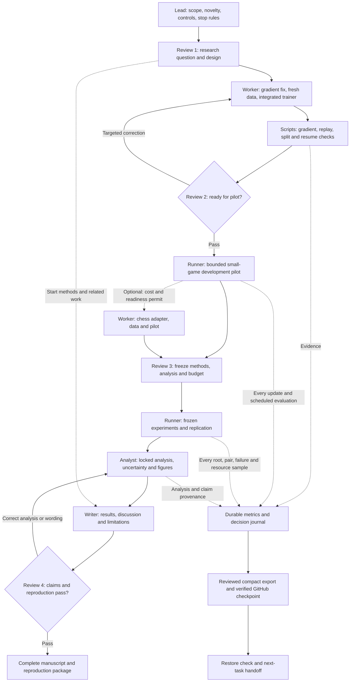

**Recommendation:** one lead agent, one worker used on demand, and one
independent reviewer invoked at four consequential checkpoints. Deterministic
programs execute experiments and produce tables. Agents make decisions,
implement changes, interpret evidence, and write the paper.

This is an economical design for this repository, not a measured claim of
minimum possible token usage. Agent usage and the **$50/month compute budget**
are separate budgets. Model names and reasoning levels remain unassigned:
the user must approve the exact model/effort for every created agent. This
design does not create agents, rent hardware, or authorize training.

**Audit revision, 25 October 2026:** the [research audit](COUNTERPLAY_WORKFLOW_RESEARCH_AUDIT_2026-10-25.md)
and [metrics/recovery contract](COUNTERPLAY_METRICS_AND_RECOVERY_2026-10-25.md)
add durable measurement events, failure accounting, explicit result-release
rules, regular verified GitHub checkpoints, and recovery checks at every
milestone. The user selected GitHub-only backup with large artifacts kept
local. Source and small published results survive laptop loss; local-only
datasets/checkpoints do not. The cadence is an active-work policy, not an
installed unattended service. Future trainer/evaluator wiring remains a gate.

**1. End-to-end workflow**

The lead owns the sequence and the durable state. Each rectangle is a task
with a concrete output, not a permanently running specialist agent. Reviewer
checkpoints can approve work, identify a specific correction, or recommend
narrowing a claim. They do not require repeated user approval for routine work
already inside an approved execution envelope.

The dashed chess branch is optional and is decided using engineering
readiness, runtime, and cost before locked outcomes are examined. It is not
added because a favorable development score appears. If deferred, report the
extension plan and its measured feasibility limits; do not imply completed
chess evidence. If chess becomes a required project deliverable, adopt that
scope prospectively and allow it another monthly budget window.

Review 1 failures return to the contribution/design task. Review 3 failures
return only to the affected pilot or protocol decision. Invalid data or a
material correctness defect discovered later invalidates affected results:
return to the relevant upstream stage with a versioned incident record.
The diagram's final correction loop is for valid analysis/writing repairs,
not permission to conceal scientific defects or tune against final results.

**2. Agent roles and when to invoke them**

| Role | Invocation | Input | Required output |
| --- | --- | --- | --- |
| Lead / research owner | One active project chat, resumed at milestones | Current state, approved protocol, changed evidence | One bounded next task, decision record, updated issue status |
| Worker | One task at a time; coding, data, analysis, or writing mode | Narrow task packet and relevant source/artifacts | Verified change or analysis, artifact paths, concise handoff |
| Independent reviewer | Four milestone reviews; targeted re-review after relevant fixes | Frozen question, implementation diff, evidence, acceptance criteria | Pass/fail/conditional disposition; blocking findings with evidence and a closure condition |
| Experiment runner | Ordinary process, not an LLM agent | Immutable config, code/data identities, explicit resource limits | Checkpoints, structured metrics, failures, costs and exit status |

The lead can do a short task directly when delegation would cost more than
the work. A worker context can be reused within a coherent implementation
phase; change roles serially rather than running separate architect, data,
trainer, statistician, and writer agents continuously. A fresh concise packet
is preferable when the phase changes substantially.

The reviewer must not author the code/protocol being reviewed. A separate
reviewer context offers useful independence from the author's narrative; it
does not substitute for mathematical checks, independent rule implementations,
or eventual human scientific review. Give the reviewer evidence and the exact
claim, not a transcript designed to persuade them that the work is correct.

Default to **one active reasoning agent at a time**. The lead may be idle
while a worker, reviewer, or experiment runs. At most two reasoning agents
should work concurrently, and only when tasks are genuinely independent and
the benefit justifies the additional usage. No recursive delegation or agent
debate loops. Model/effort approvals must be preserved without silent fallback.

**3. Stage contracts and completion gates**

| Stage | Work | Deliverable and acceptance rule |
| --- | --- | --- |
| 0. Define contribution | Lead conducts a bounded primary-source comparison; specify critical-reply/intervention question, baselines, population, reference semantics and failure rules | One-page contribution statement and prospective protocol. Review 1 accepts a testable, differentiated claim or narrows it before expensive implementation |
| 1. Repair foundations | Worker fixes covariance-gradient weighting; checks all affected arms; resolves data duplicate/shared-start rules; uses fresh small-game episodes; integrates trainer and evaluator | Numerical derivatives agree within declared tolerances; all retained transitions replay; prohibited split overlap is zero; checkpoint/resume behavior verified. Review 2 accepts pilot readiness |
| 2. Run bounded development | Runner performs tiny learning checks and a capped pilot; lead assesses learning curves, coverage, costs and precision | Complete pilot receipt, issue disposition and a single final configuration proposal. No open-ended duration/weight/seed sweep |
| 3. Decide chess and freeze | Optional worker adapts chess encoding/actions, full-history outcome validation, trajectories, position tests and paired arena; reviewer examines the pilot-based final design | Review 3 freezes arms, datasets, seeds, references, metrics, multiplicity, analysis, failure policy, match schedule and cost limits. Chess inclusion is decided here |
| 4. Execute the study | Runner executes the predeclared cells and replication; lead reacts only to actionable completion/failure/budget events | Every cell accounted for as completed, failed, invalidated or not run. Resume partial work safely; no favorable-seed selection or silent replacements |
| 5. Analyze | Worker in analyst mode runs fixed scripts over locked outputs; estimates uncertainty with root/episode and training-seed dependence respected | Machine-generated tables/figures; all planned contrasts and failures; separate exact, finite-horizon and engine-reference quantities. No post hoc promotion of favorable endpoints |
| 6. Write and reproduce | Worker in writer mode completes methods, results, limitations and discussion; verify claims and citations against source artifacts | Review 4 accepts claim-to-result traceability and a clean environment reproduction of the declared artifact scope. Manuscript and reproduction instructions complete |

Writing begins at Stage 0: related work, research question, protocol, methods
and limitations can be drafted before results exist. Results placeholders
must stay explicit. Abstract conclusions are finalized after locked analysis.

Before Review 3, test analysis scripts on synthetic outcomes, check uncertainty
procedures against design-matched simulations, and validate reference solvers
on tractable exact cases. Decide whether the planned precision is affordable
using development evidence. Changing an analysis after seeing locked results
must be disclosed and treated as exploratory unless it is a documented bug
correction with its consequences reported.

The first tasks in Stage 1 are the known covariance-gradient defect, the
dataset contract, and an integrated training path. The active checkout has no
accepted current corpus. The recovered historical archive is useful for
reproduction; it is not a replacement for the new H4/policy/split contract.

**4. Keep context small and decisions durable**

Use the following working records incrementally; avoid empty scaffolding or a
new orchestration framework. `research/STATE.md` and the durable ledger tools
now exist; the remaining proposed records are created when their stage needs
them. The metrics/recovery contract governs event cadence and publication.

| Proposed record | Purpose |
| --- | --- |
| `research/STATE.md` | Current protocol/commit, active stage, last verified evidence, blockers, budget and next task; target roughly 500–800 words |
| `research/issues.csv` | One issue identifier, severity, owner role, fix/retirement plan, acceptance evidence and status; migrate the existing review issues rather than creating duplicate lists |
| `research/protocol.yaml` | Frozen scientific choices, data contracts, metric definitions, planned cells and stop rules |
| `research/decisions.md` | Short append-only reasons for adopted changes, including superseded choices |
| `research/runs.csv` | Run identities, manifests, statuses, durations, costs and artifact hashes; generated by scripts |
| `paper/main.tex`, `paper/references.bib`, `paper/claims.csv` | Manuscript, verified citations, and mappings from claims to data/config/result/figure identities |

Large raw artifacts remain in ignored storage. Small curated receipts and
source/configuration changes belong in Git. Mirror human-readable milestone
notes to Obsidian; avoid repeating the entire research history in each note.
Commit and normally push verified milestones under the user's October 25
standing authorization, targeting at most 15 minutes between safe checkpoints
during active work, and at experiment/session boundaries. Verify the remote
hash. No force-push or large generated-data upload. Report missed checkpoints
and the remaining local-only exposure; a local commit is not a remote backup.

Each delegated task packet should normally fit in **about 1,000–1,500 tokens**:
objective; input files and identities; allowed edits; constraints; exact
acceptance evidence; resource allowance; stop/escalation conditions. These are
context targets, not hard limits that justify omitting critical evidence.

The worker handoff should normally fit in **300–500 tokens**: what changed,
artifact paths, checks run and results, remaining issue, and recommended next
action. Full evidence lives in files. Never copy the whole chat history into
every task. Load the long Ground Truth or archived protocols only for a
specific unresolved question.

**5. Rules that reduce usage without weakening the study**

1. **Use scripts for repetition.** No LLM call per epoch, batch, position,
   move, match, bootstrap sample, or log line. Agents author/debug the runner;
   the runner performs the work and emits compact structured summaries.
2. **Reuse existing infrastructure.** Repair the current objective and reuse
   rules, replay, optimizer and arena components where their contracts fit.
   A custom multi-agent platform or GPU rewrite is not a prerequisite.
3. **Review consequential changes.** Use the four checkpoints above. For a
   small correction, re-review its diff and affected evidence rather than
   restarting a whole-repository audit. Do not waive a scientific blocker to
   meet a reviewer-call quota.
4. **Escalate reasoning selectively.** Use approved less expensive settings
   for mechanical edits, extraction, formatting and routine implementation.
   Reserve stronger reasoning for objectives, novelty boundaries, leakage,
   causal interpretation and uncertainty. Exact models remain user-selected.
5. **Cache deterministic work.** Key reference results, parsed data and
   reports by their actual inputs/code/configuration. Verify identity before
   reuse. Do not reuse stale outputs after a relevant change or treat old
   inspected evaluation data as a fresh holdout.
6. **Bound development.** Start with one pilot configuration and permit at
   most two scientifically justified revisions in that development budget.
   After two failed repair attempts on the same blocker, diagnose the cause
   and revise scope/approach explicitly instead of repeating the same action.
   An unresolved blocker stays unresolved; it is not converted into a pass.
7. **Monitor events, not unchanged logs.** A process emits a durable completion,
   failure, or resource-limit event. Resume agent reasoning for actionable
   events. Do not use recurring LLM status checks merely to say a run is still
   running. Monitoring reliability is itself checked before unattended work.
8. **Generate numbers once.** Tables and plots come from versioned analysis
   outputs; the writer cites them rather than manually recalculating values.
   Run relevant checks after meaningful changes, not the full suite after
   every documentation edit.
9. **Limit repeated literature searches.** Cache the primary-source crosswalk
   at scope freeze and refresh it near manuscript completion. Search between
   those points only for a concrete unresolved novelty/method question.

Measure input/output tokens or billed usage where the service exposes them,
agent activations, task retries and wall time. Compare actual cost per accepted
milestone; do not invent a percentage saving before running this workflow.

**6. Compute and experiment envelope**

The proposed monthly allocation remains **$35 compute + $10 storage/transfer
+ $5 contingency**, within the user's $50 ceiling. Actual rental prices,
availability and stop/storage billing must be checked at execution time.
Paid provisioning requires the user's applicable spending authorization;
stating a budget is not a request to rent hardware now. Agent/API spending is
not assumed to fit inside this GPU budget.

The current NumPy models use CPU computation. Measure a local end-to-end pilot
before deciding whether a GPU implementation would pay for its development
and transfer overhead. Reference generation and game search may dominate cost.

The earlier **five arms × ten paired seeds × two training corpora = 100 fits**
is a planning envelope, not a mandatory starting run or a proven affordable
panel. The two games share a model in that proposal, so do not multiply by two
again. A smaller final design must be justified and frozen using development
cost/precision evidence before final outcomes; it must retain the controls
needed for the paper's actual claims.

Chess is a separately costed extension. A minimal pilot can check multi-step
JEPA, value-only latent rollout and direct evaluation under a common search;
the final controls depend on the frozen claim. Position diagnostics and a
bounded paired-match schedule come before a large Elo tournament. Do not
present an imprecise relative Elo estimate as a human rating or proof of a
representation mechanism.

All planned runs have runtime, memory and cost ceilings, checkpoints where
appropriate, and explicit failure status. Stop the queue at the approved
resource limit and preserve pending cells. A budget stop permits resumption
under a later approved allocation; it does not permit cherry-picking completed
results or claiming the planned study finished.

**7. What counts as finished**

The scientific workflow is complete when the adopted study has a valid,
accounted-for outcome and the manuscript accurately describes it. The final
package needs:

- A precise contribution statement with verified primary-source attribution.
- Reproducible data construction/splits, objective, controls and evaluation.
- All planned cells accounted for, with invalidated/unrun work and deviations
  explicit; no result presented as validated if its correctness is unresolved.
- Primary and secondary results, uncertainty, costs and limitations, including
  null and negative findings. A JEPA win is not a completion gate.
- Generated figures/tables with quantitative claims traced to immutable
  results, plus a checked bibliography and complete manuscript.
- A clean-environment check of the declared reproduction scope. If full
  rerunning exceeds budget, distinguish the reproduced minimal case and
  regenerated analysis from experiments not freshly rerun.
- Review 4 findings resolved or claims narrowed transparently. Any remaining
  material limitation appears in the paper and artifact instructions.

A failed feasibility study can still yield a complete technical report if
the question and deliverable are explicitly narrowed. It must not be labelled
successful completion of an unexecuted method study. High novelty, informative
results and publication acceptance cannot be guaranteed by orchestration.

**8. Immediate execution order once the agent configuration is approved**

The lead reads the current review and data-readiness note, creates the compact
state and issue register, and prepares the prospective protocol for Review 1.
After that disposition, the first worker task fixes and verifies the
covariance gradient. The second finalizes the split/window contract. The third
builds the smallest audited corpus and integrated trainer path. This sequence
keeps the first paid experiment behind the known correctness/data blockers.

Supporting repository notes: `docs/PROJECT_REVIEW_2026-10-25.md` and
`docs/COUNTERPLAY_CHESS_AND_DATA_READINESS_2026-10-25.md`. The design preserves
the existing artifact exclusions and the user requirement for explicit agent
model/effort approval. No agents, monitors, rentals, datasets or experiments
were started by writing this plan.
