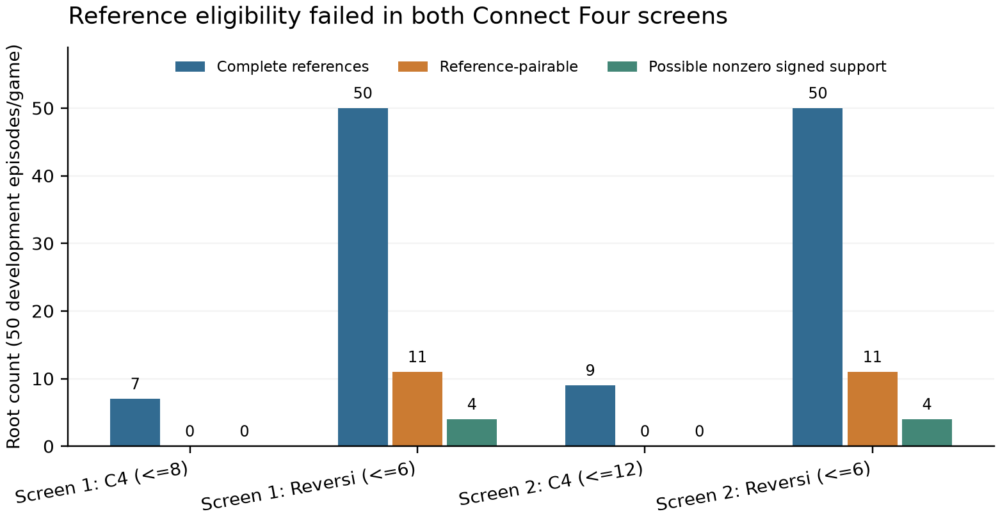

# Counterplay CP-01: A failed feasibility screen for matched critical-reply repairs

Technical report - 25 October 2026

## Abstract

An intervention study needs an eligible population before it needs a trained
model. We examined the feasibility of CP-01, a proposed audit comparing equal,
same-direction scalar corrections at critical and noncritical opponent replies
inside exact-rule adversarial search. A first development screen and one
prospectively reviewed amendment reused the same 164 behavior episodes in
Connect Four 6x7 and Reversi6. Every attempted terminal-solved reference fork
completed: 57 in the first screen and 59 in the amendment. Neither screen
yielded a repairable critical-reply root in Connect Four; Reversi yielded
11 of 50 roots, only four with potential nonzero signed-error common support.
The revised design therefore failed its frozen eligibility gates and stopped
before trainer construction. We explain a support constraint: with predictions
bounded in [-1,1], reference values -1 and +1 admit no shared strictly positive
or strictly negative residual stratum. We report finite-screen counts,
dependence, costs and reconstruction evidence. These are results about this
audit design and sampled population, not about JEPA playing strength or the
absence of critical replies in either game.

## 1. Motivation and scope

Predictive models used in planning must preserve distinctions that affect
decisions. In an adversarial fork, one opponent reply can determine an own
action's minimum utility. An average prediction error need not emphasize that
reply. CP-01 proposed to examine whether the location of an error matters
after matching its magnitude and correction direction within a checkpoint.
The intended empirical contribution was a common-utility, complete-fork audit,
not a new representation principle, architecture, or superiority claim.

This report asks a narrower question: does the declared development population
support that proposed matched intervention under its actual rules? It records
the prescribed feasibility stop. The learned-model study was not executed.
No loss, regret, reply-preservation, match score, Elo, or model-effect estimate
is available. No model-comparison null hypothesis was tested.

## 2. Related work and claim boundary

[MuZero](https://arxiv.org/abs/1911.08265) establishes learned-model game
planning; [Value Equivalence](https://proceedings.neurips.cc/paper/2020/hash/3bb585ea00014b0e3ebe4c6dd165a358-Abstract.html)
establishes the importance of preserving quantities used by value planning.
CP-01 does not claim either idea as new.

[AD-WM](https://arxiv.org/html/2609.30264v1), section III-E, measures candidate
ranking and elite-selection regret in each model's planning space.
[Counterfactual Action Evaluation](https://arxiv.org/html/2610.02860v1), section
4.2, traces exact-state action interventions through observations, embeddings
and predictions. [Dual-Frontier](https://arxiv.org/html/2609.26293v2), appendix
A.1, specifies which operator, action, budget and randomness must remain fixed
under oracle replacement. [One-Step Prediction Fidelity](https://arxiv.org/html/2610.19375v1),
section 3.3, uses paired planning and matched continued-training controls when
examining prediction/planning dissociation.

These precedents limit any claim that counterfactual forks, decision-relevant
error, oracle substitution, or a negative prediction/planning association is
itself novel. CP-01's candidate distinction was the operational definition of
opponent-reply criticality and matched repairs on common terminal utilities.
The present evidence does not validate that distinction as an effective
diagnostic. The source comparison is targeted, not an exhaustive novelty
review; no methods-paper priority or publication-readiness claim is made.

## 3. Prospective design and feasibility methods

### 3.1 Forks, criticality and the intended intervention

For root state s, own action a, and opponent reply b, let q(s,a,b) be terminal
minimax utility for the root player after those two exact legal transitions.
Utilities are -1, 0, or +1. Define Q(s,a) = min_b q(s,a,b), and V(s) = max_a Q(s,a).
A terminal own action has exact utility without a reply set. Regret of a
selected action is V(s) - Q(s,a_selected), in [0,2]. Only terminal-complete
references are used; no fixed-horizon value is called full-game regret.

A critical reply is a unique worst reply to a suboptimal action, separated
from the next-worst reply by at least 0.5, whose deletion would raise that
action's minimum to at least the original root optimum. The primary candidate
also requires a nonterminal critical child and a nonterminal, noncritical
control under the same own action. Lexicographic selection occurs using
references before model scores. Terminal replies remain exact and are not
repairable learned entries. A forced Reversi pass consumes a ply and switches
the actor; terminal detection precedes expansion.

The proposed primary intervention would replace one predicted scalar q_hat
with its common reference value. Its within-checkpoint contrast was regret
after noncritical repair minus regret after critical repair, restricted to
matched checkpoint/root units in multi-step JEPA. Controls would match residual
sign and absolute-error magnitude within 0.1. Ties use action IDs; the
zero/near-zero residual stratum has a 1e-10 tolerance. Match coverage is part
of the estimand, not a removable inconvenience. A zero-match or unresolved
seed would make the equal-seed primary estimate missing. No such model
estimate was computed here.

Five arms were contemplated: multi-step and H1-only JEPA, value-only latent
rollout, decoded-state rollout, and exact-state direct-leaf. The value-only
latent arm was the relevant identical-path auxiliary-objective control;
direct and decoded paths were intentionally different and could not by
themselves identify a JEPA effect. Behavior-outcome supervision was distinct
from minimax references. Re-encoding and reference substitution would be
privileged descriptive diagnostics, not proof of information loss. No final
seed/count panel was frozen, and none of these fits ran.

### 3.2 Episodes, windows, isolation and references

The development recipe generated 32 training and 50 development episodes per
game. Episode-index cycling assigned four ordered pairs of uniform and tactical
policies. Tactical play selected an immediate win if available, otherwise a
move without an immediate losing reply when possible, otherwise a legal move;
ties were uniform. The split/game/episode seed came from a fixed SHA-256
namespace. Every generated state, legal set and successor was compared with
the separately implemented bitboard rules. This is same-project independent
code, not a third-party engine validation or formal proof.

Each selected training window contained four legal transitions ending
nonterminal, supplying valid H1/H2/H4 targets for every arm. Short/terminal
windows were counted and excluded. Canonical path/content duplicates were
collapsed with source multiplicities retained. Selection was by hash, not
outcome. The bank contained 128 unique windows/game for training and 32/game
for development. Evaluation root canonical keys were excluded from all selected
root and future-state targets. This is selected-position isolation; common
openings and unmeasured reference-descendant overlap preclude a whole-tree
or complete state-disjointness claim.

Each development episode contributed at most one nonterminal late root with
at least two own actions, selected by minimum hash before solving. The first
screen allowed at most eight empty cells in Connect Four and six in Reversi.
No candidate, duplicate, failed reference, or ineligible root was replaced.
The independent negamax solver completed every legal two-ply fork to terminal
minimax values or rejected the entire root. The cap was 100,000 solver nodes
and two wall seconds per root. The node convention counts solver visits,
not every outer exact-rule call; wall/CPU measurements include construction.

### 3.3 Gates, amendment and costs

The initial engineering gate required at least five reference-pairable roots
per game and at least 90% reference completion. These are minimum feasibility
floors, not power or representativeness guarantees. After the first failure,
an independent scientific review approved one final prospective revision:
Connect Four's empty-cell limit increased from eight to twelve, with the
original episodes, seed namespace, pre-solve selection and solver caps fixed.
Reversi remained unchanged. Source and amended protocol were pushed and
verified before invocation.

The amendment additionally required at least two roots/game and at least 20%
of pairable roots with potential nonzero signed-residual common support.
This tests only domain possibility, not actual model matching. The first
batch's CPU time was subtracted from a cumulative 300 builder-CPU-second cap;
an external 330-second wall deadline bounded each invocation. A 2 GiB address
space limit applied to the data producer. Failed gates remained durable
events. The amendment permitted one invocation, with an explicit no-further-
screen stop implemented by the operator/protocol rather than a software lock.

## 4. Findings

### 4.1 Reference and support yield

{{GENERATED_TABLES}}

All attempted references completed, so the failed gate cannot be attributed
to solver timeouts in this batch. In the first Connect Four screen, five of
seven roots had all own-action reference minima tied. Its sole root-decision-
critical action had a terminal critical child, which the study correctly
treated as exact rather than repairable. Widening the window admitted nine
roots but still no eligible matched-repair population. This does not show
that earlier or differently sampled Connect Four positions lack nonterminal
refutations.

Both screens retained 256 training and 64 development windows and passed that
count gate. The first bank's prohibited selected-state/root collision count
was independently recomputed as zero. Exact decoded episode-list comparison
verified that all 164 episodes were identical across screens. There were not
328 independent episodes or two independently generated replication corpora.
Window integrity and reference completion did not rescue scientific eligibility.

### 4.2 A bounded-value constraint on signed matching

Let predictions lie in [-1,1] and let e = q_hat - q_ref. When the critical
reference is -1, e_critical is nonnegative. When its control reference is +1,
e_control is nonpositive. They cannot both be strictly positive or both be
strictly negative, regardless of training. At exact zero, a scalar correction
does nothing. With the declared numerical tolerance, both can enter the
zero/near-zero stratum; that is not evidence of nonzero positive/negative
common support, and a tiny correction near a decision tie need not be harmless.
We make no claim that this stratum was observed or has a measured effect.

The first Reversi screen contained twelve critical=-1/control=+1 branch pairs
under its selected reference candidates, and six critical=0/control=+1 pairs.
Only four roots had any control with potential nonzero same-sign domain
support. A domain-possible pair may still fail the 0.1 caliper or actual
model coverage. This algebraic constraint explains why a large reply bank
or additional training is not sufficient to guarantee this primary estimand.
It is a property of the proposed diagnostic, not a new theorem about JEPA.

### 4.3 Stop disposition and unavailable outcomes

The final screen failed both reference-yield and necessary-support gates in
Connect Four. The frozen stop rule retired the two-game mechanism design
before trainer construction. No third root screen ran. No development model
pilot, final panel, locked evaluation, second training corpus, paired match,
or chess extension was executed. The earlier 100-fit planning envelope was
not an executed or finally scheduled experiment. Loss/regret/Elo results
remain unavailable, not zero. Review 2 did not approve pilot readiness, and
the locked-study Review 3 was not reached.

The two builders consumed 31.534 CPU seconds in total, excluding mathematical
tests, agent reasoning, packaging and report rendering. No rental was initiated.
Actual agent tokens and billing were not exposed and remain missing. A monthly
$50 compute ceiling is a budget, not measured expenditure. These distinctions
prevent a cheap feasibility screen from being presented as a complete study's
compute or agent cost.

## 5. Discussion and limitations

The useful conclusion is that CP-01 v3 should not be trained as specified:
its chosen Connect Four population supplies no eligible primary units, and
even Reversi's reference-pairable population substantially overstates possible
strict-sign support. This validates the decision to screen the diagnostic
before implementing a trainer; it does not validate the diagnostic's scientific
mechanism or favor any model family.

Eligibility depends jointly on root sampling, uniqueness of the worst reply,
root-level deletion criticality, exact terminal overrides, same-action
nonterminal controls, and residual matching. Rare eligibility is therefore
not evidence that opponents rarely have decisive replies. Removing an
eligibility restriction after seeing these screens would change the question.
A Reversi-only design, controlled perturbation study, or broader root generator
could be investigated prospectively, but none is silently substituted here.

The recipe is small, same-size, policy-dependent and late-game. There are no
population prevalence intervals, power estimates or general board-game claims.
The two screens are dependent and the descriptive report scope was adopted
after development observations; it is not a confirmatory preregistration.
The mathematical support check is necessary, not sufficient. Project-owned
independent rules can share errors; tractable differential fixtures do not
prove every reference. Timing is local to the documented host, and peak RSS
is the observed process statistic, not a complete memory history.

Foundation work separately repaired a covariance-gradient weighting mismatch:
all six affected arms and every parameter tensor passed 192 synthetic numerical
checks after 35 baseline failures. That engineering result does not constitute
learning or model-performance evidence. Integrated training, optimizer/EMA/RNG
resume, production measurement cadence, scalable exports, inferential analysis
calibration and independent final evaluation remain prerequisites for any
future learned-model study, rather than completed features of this report.

## 6. Reproducibility and evidence boundaries

The repository preserves both prospective protocol versions, the reviewed
amendment, source identities, every failed gate, compact per-root rows,
generated tables/figure and the claim map. Detailed commands are in
[REPRODUCE.md](REPRODUCE.md). The report's tables and plot can be regenerated
from published receipts and unit CSVs without raw boards or fitted weights.
The two data-building source commits and exact data SHA-256s identify optional
raw regeneration in separate checkouts; reruns are recovery attempts, not
permission to extend this stopped study.

GitHub is the selected off-device destination. Raw episodes, windows,
checkpoints, environments and logs remain local and ignored. A source hash
does not reconstruct missing bytes by itself. A fresh clone of the documented
earlier milestone passed ten focused tests using the same host and existing
environment; this was not replacement-machine recovery or recovery of raw data.
The final package's scoped review/recovery receipt identifies what was actually
verified. The PDF is an automated project technical report, not a submitted
paper or a claim of acceptance-ready novelty.

## 7. Conclusion

Two finite, dependent screens failed the declared population gates for the
CP-01 two-game matched critical-reply study. Complete references and usable
training windows did not imply that the primary matched population existed.
The audit stopped before model training, preserved its unsuccessful attempts,
and exposed a bounded-value/sign-support constraint that must be considered
in any redesign. No conclusion about JEPA effectiveness follows.

## References

1. Schrittwieser et al. Mastering Atari, Go, Chess and Shogi by Planning with a Learned Model. [Primary paper](https://arxiv.org/abs/1911.08265).
2. Grimm, Barreto, Singh and Silver. The Value Equivalence Principle for Model-Based Reinforcement Learning. NeurIPS 2020. [Proceedings](https://proceedings.neurips.cc/paper/2020/hash/3bb585ea00014b0e3ebe4c6dd165a358-Abstract.html).
3. Qiu et al. AD-WM: Action-Discriminative World Models for Counterfactual Model Predictive Control. Version 1, 24 September 2026. [Paper](https://arxiv.org/html/2609.30264v1).
4. Subramanian. Counterfactual Action Evaluation, Observation Bottlenecks, and Representation Geometry in Joint-Embedding Predictive World Models. Version 1, 2 October 2026. [Paper](https://arxiv.org/html/2610.02860v1).
5. Zhu et al. Dual-Frontier: When Can an Agent Trust Its World Model? Version 2, 24 September 2026. [Paper](https://arxiv.org/html/2609.26293v2).
6. Cheung and He. One-Step Prediction Fidelity Is a Poor Proxy for Planning Performance in JEPA World Models. Version 1, 14 October 2026. [Paper](https://arxiv.org/html/2610.19375v1).
